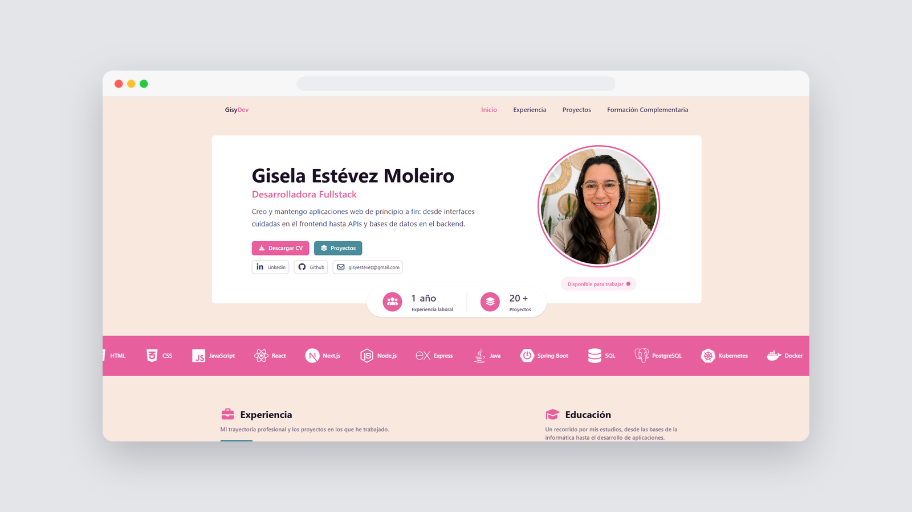

# Portfolio de Gisela Estévez Moleiro

Portfolio web personal de **Gisela Estévez Moleiro**, desarrolladora full stack. Presenta su trayectoria profesional, formación, tecnologías y proyectos, junto con enlaces de contacto y acceso a su currículum.



## Contenido

- **Sobre mí:** perfil profesional, disponibilidad y formas de contacto.
- **Tecnologías:** carrusel con herramientas y lenguajes de desarrollo.
- **Experiencia y educación:** recorrido profesional y académico.
- **Proyectos:** fichas con capturas, tecnologías utilizadas y enlaces a demos o repositorios.
- **Formación complementaria:** cursos y certificaciones.

Entre los proyectos destacados están **TransferLog**, una aplicación para la gestión de empleados y turnos; **Quiosco Next**, una aplicación de pedidos con panel de administración; y **Weather App**, una aplicación meteorológica con previsiones y gráficos interactivos.

## Tecnologías

- React 19 y TypeScript
- Vite 8
- Tailwind CSS 4
- React Router
- Motion para animaciones
- GitHub Pages para el despliegue

## Requisitos

- Node.js 20 o superior
- npm

## Desarrollo local

La aplicación se encuentra dentro de `portfolio-frontend`:

```bash
cd portfolio-frontend
npm install
npm run dev
```

Vite mostrará en la terminal la dirección local para abrir el portfolio en el navegador.

## Comandos disponibles

Ejecuta estos comandos desde `portfolio-frontend`:

| Comando | Descripción |
| --- | --- |
| `npm run dev` | Inicia el servidor de desarrollo. |
| `npm run build` | Comprueba los tipos de TypeScript y genera la versión de producción en `dist`. |
| `npm run preview` | Sirve localmente la versión generada. |
| `npm run lint` | Analiza el código con ESLint. |

## Despliegue

El repositorio incluye un flujo de GitHub Actions que construye el sitio y lo publica en GitHub Pages al actualizar la rama `main`. Vite configura la ruta base `/portfolio/` para la versión de producción.

## Estructura

```text
portfolio-frontend/
├── docs/images/          # Imagen de presentación del README
├── public/               # Imágenes, iconos y documentos del portfolio
├── src/
│   ├── lib/              # Utilidades para recursos estáticos
│   └── portfolio/
│       ├── components/   # Componentes reutilizables
│       ├── data/         # Contenido del portfolio
│       ├── hooks/        # Hooks de navegación, tema y animación
│       ├── layout/       # Estructura general de páginas
│       ├── page/         # Página principal
│       └── ui/           # Secciones visuales
└── package.json
```
